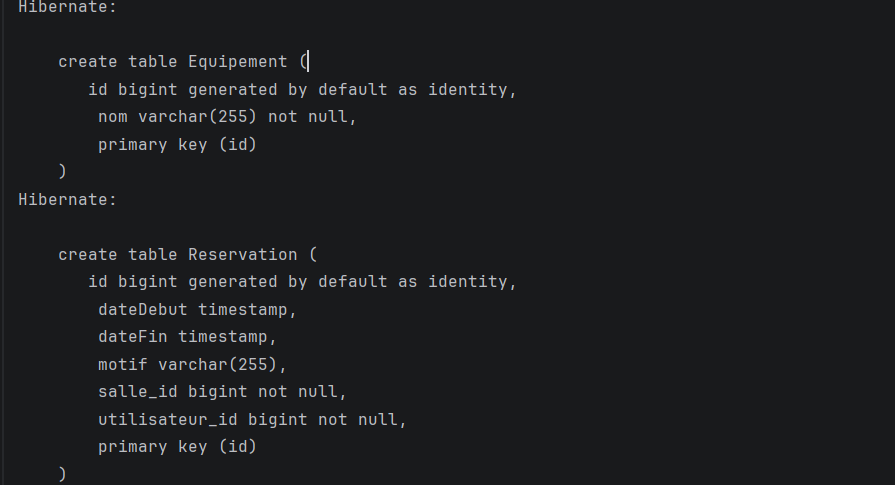
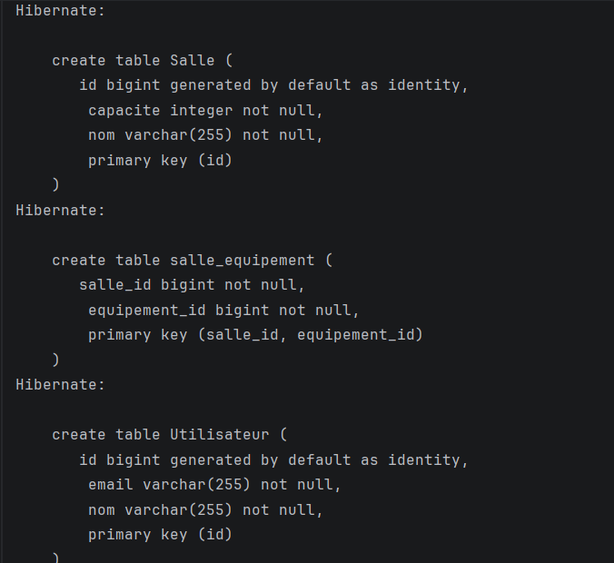
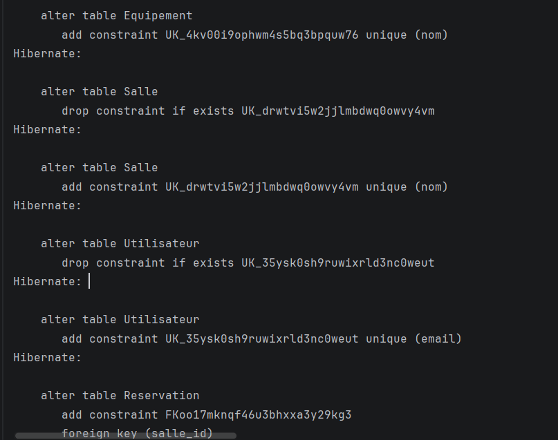
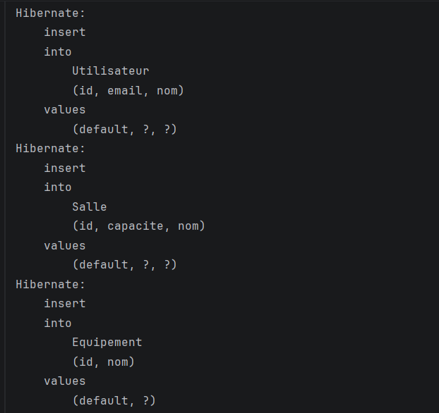

# Gestion des réservations — JPA / Hibernate

Application Java (Maven) de gestion de réservations de salles, utilisant JPA avec Hibernate et une base H2 en mémoire. Elle gère quatre entités (Utilisateur, Salle, Réservation, Équipement) avec des relations OneToMany, ManyToOne et ManyToMany, ainsi que les cascades et la suppression orpheline.

